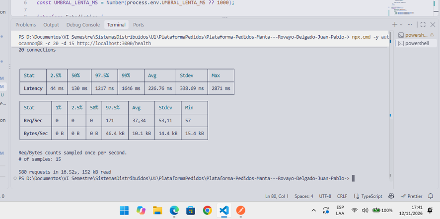
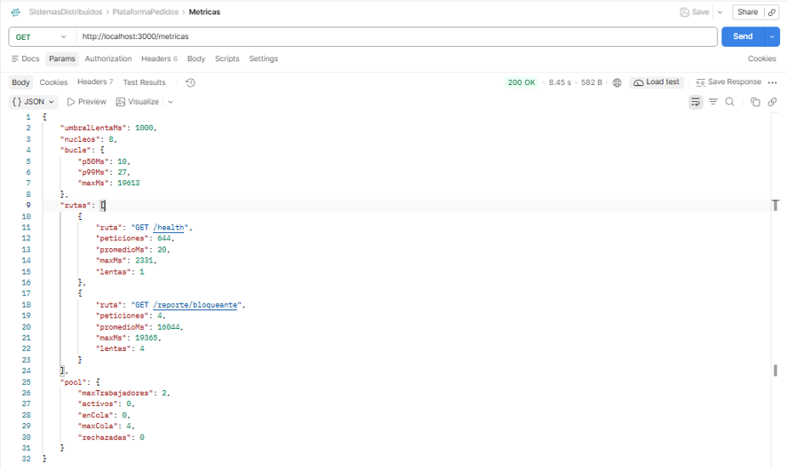
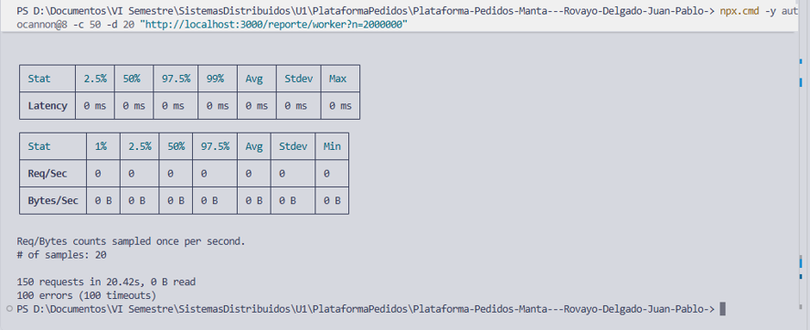
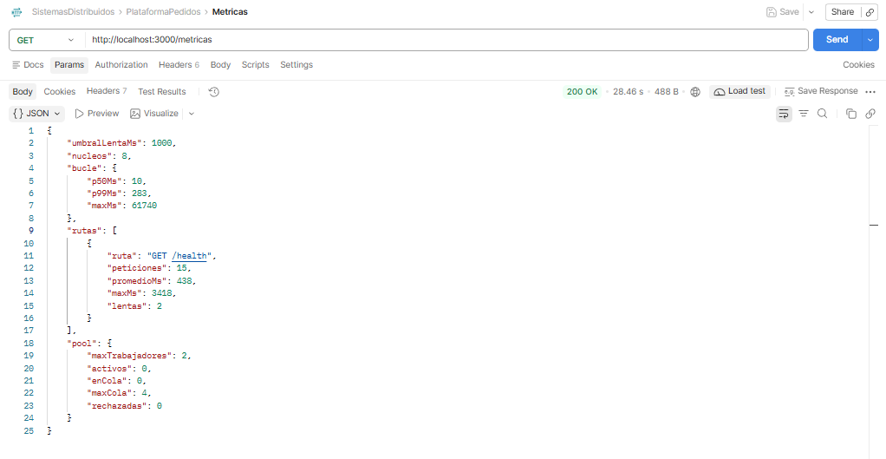
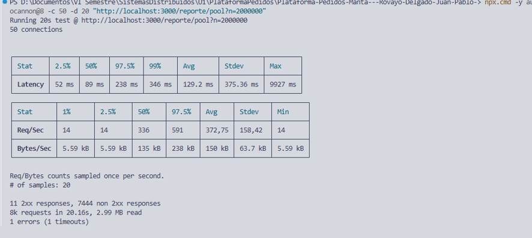
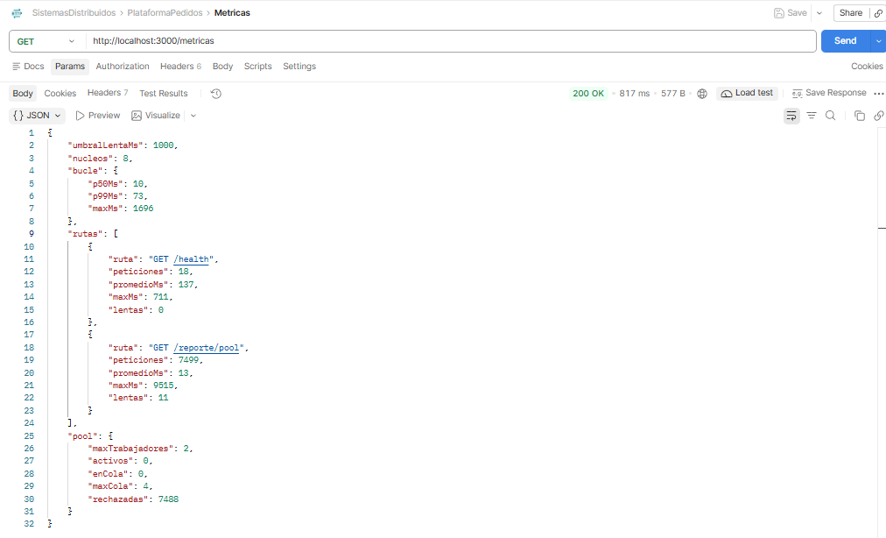

# Bitácora · Arquitecturas y procesos · Juan Pablo Rovayo Delgado

## Entorno

| Dato | Valor |
| --- | --- |
| Laptop (CPU, RAM) | Lenovo V15 ADA, AMD Ryzen 5 3500U, 8 GB DDR4 (3,4 GB utilizables) |
| Núcleos según /metricas | 8 |
| MAX_TRABAJADORES y MAX_COLA | 2 trabajadores y 4 trabajos en cola |
| Duración de un reporte con n=2000000 | 5385 ms (5,39 segundos) |

## 1. Resultados

Se realizaron tres escenarios de prueba utilizando autocannon 8 para comparar el bloqueo del bucle de eventos, la creación de Worker Threads sin límite y el uso de un pool con concurrencia controlada.

| Escenario | Latencia 50 % | Latencia máx. | Respuestas 2xx | Respuestas 503 | Timeouts | bucle.maxMs |
| --- | --- | --- | --- | --- | --- | --- |
| 1 · bloqueo (/health) | 130 ms | 2871 ms | 580* | 0 reportadas | 0 reportados | 19613 ms |
| 2 · worker sin límite | N/D | N/D | 0 | 0 observadas | 100 | 61740 ms |
| 3 · pool con límite | 89 ms | 9927 ms | 11 | 7444** | 1 | 1696 ms |


**Nota 1:** En el escenario 1, las 580 respuestas 2xx se infieren del total de solicitudes completadas, el funcionamiento de `/health` y la ausencia de errores reportados.

**Nota 2:** En el escenario 3, autocannon contabilizó 7444 respuestas non-2xx. Se atribuyen a los rechazos HTTP 503 del pool, aunque la herramienta no muestra el desglose por código.


### Escenario 1. Bloqueo del bucle de eventos

Se ejecutaron 20 conexiones concurrentes durante 15 segundos contra `/health`. Durante la ejecución se enviaron solicitudes a `/reporte/bloqueante` para provocar el bloqueo del hilo principal.

**Comando utilizado:**

```powershell
npx.cmd -y autocannon@8 -c 20 -d 15 http://localhost:3000/health
```

**Salida de autocannon:**

```text
Running 15s test @ http://localhost:3000/health
20 connections

Stat       2.5%    50%     97.5%    99%      Avg        Stdev      Max
Latency    44 ms   130 ms  1217 ms  1646 ms  226.76 ms  338.69 ms  2871 ms

Stat        1%    2.5%   50%   97.5%   Avg     Stdev   Min
Req/Sec     0     0      0     171     37.34   53.11   57
Bytes/Sec   0 B   0 B    0 B   46.4 kB 10.1 kB 14.4 kB 15.4 kB

Req/Bytes counts sampled once per second.
# of samples: 15

580 requests in 16.2s, 152 kB read
```

**Evidencia de autocannon:**



**Respuesta de GET /metricas:**

```json
{
  "umbralLentaMs": 1000,
  "nucleos": 8,
  "bucle": {
    "p50Ms": 10,
    "p99Ms": 27,
    "maxMs": 19613
  },
  "rutas": [
    {
      "ruta": "GET /health",
      "peticiones": 644,
      "promedioMs": 20,
      "maxMs": 2331,
      "lentas": 1
    },
    {
      "ruta": "GET /reporte/bloqueante",
      "peticiones": 4,
      "promedioMs": 16044,
      "maxMs": 19365,
      "lentas": 4
    }
  ],
  "pool": {
    "maxTrabajadores": 2,
    "activos": 0,
    "enCola": 0,
    "maxCola": 4,
    "rechazadas": 0
  }
}
```

**Evidencia de métricas:**



### Escenario 2. Worker Threads sin límite

Se ejecutaron 50 conexiones concurrentes durante 20 segundos contra `/reporte/worker`. Cada solicitud crea un nuevo trabajador para realizar el cálculo de números primos.

**Comando utilizado:**

```powershell
npx.cmd -y autocannon@8 -c 50 -d 20 "http://localhost:3000/reporte/worker?n=2000000"
```

**Salida de autocannon:**

```text
Running 20s test @ http://localhost:3000/reporte/worker?n=2000000
50 connections

Stat       2.5%  50%   97.5%  99%   Avg   Stdev   Max
Latency    0 ms  0 ms  0 ms   0 ms  0 ms  0 ms    0 ms

Stat        1%   2.5%   50%   97.5%   Avg   Stdev   Min
Req/Sec     0    0      0     0       0     0       0
Bytes/Sec   0 B  0 B    0 B   0 B     0 B   0 B     0 B

Req/Bytes counts sampled once per second.
# of samples: 20

150 requests in 20.42s, 0 B read
100 errors (100 timeouts)
```

Los valores de 0 ms en la tabla de latencia no indican respuestas instantáneas, sino que no hubo respuestas completadas para calcular los percentiles.

**Evidencia de autocannon:**



**Respuesta de GET /metricas:**

```json
{
  "umbralLentaMs": 1000,
  "nucleos": 8,
  "bucle": {
    "p50Ms": 10,
    "p99Ms": 283,
    "maxMs": 61740
  },
  "rutas": [
    {
      "ruta": "GET /health",
      "peticiones": 15,
      "promedioMs": 438,
      "maxMs": 3418,
      "lentas": 2
    }
  ],
  "pool": {
    "maxTrabajadores": 2,
    "activos": 0,
    "enCola": 0,
    "maxCola": 4,
    "rechazadas": 0
  }
}
```

**Evidencia de métricas:**



### Escenario 3. Pool de trabajadores limitado

Se ejecutaron 50 conexiones concurrentes durante 20 segundos contra `/reporte/pool`, con una configuración de 2 trabajadores activos y 4 trabajos en cola.

**Comando utilizado:**

```powershell
npx.cmd -y autocannon@8 -c 50 -d 20 "http://localhost:3000/reporte/pool?n=2000000"
```

**Salida de autocannon:**

```text
Running 20s test @ http://localhost:3000/reporte/pool?n=2000000
50 connections

Stat       2.5%   50%    97.5%   99%     Avg       Stdev     Max
Latency    52 ms  89 ms  238 ms  346 ms  129.2 ms  375.36 ms 9927 ms

Stat        1%      2.5%    50%    97.5%   Avg      Stdev    Min
Req/Sec     14      14      336    591     372.75   158.42   14
Bytes/Sec   5.59 kB 5.59 kB 135 kB 238 kB 150 kB   63.7 kB  5.59 kB

Req/Bytes counts sampled once per second.
# of samples: 20

11 2xx responses, 7444 non 2xx responses
8k requests in 20.16s, 2.99 MB read
1 errors (1 timeouts)
```

**Evidencia de autocannon:**



**Respuesta de GET /metricas:**

```json
{
  "umbralLentaMs": 1000,
  "nucleos": 8,
  "bucle": {
    "p50Ms": 10,
    "p99Ms": 73,
    "maxMs": 1696
  },
  "rutas": [
    {
      "ruta": "GET /health",
      "peticiones": 18,
      "promedioMs": 137,
      "maxMs": 711,
      "lentas": 0
    },
    {
      "ruta": "GET /reporte/pool",
      "peticiones": 7499,
      "promedioMs": 13,
      "maxMs": 9515,
      "lentas": 11
    }
  ],
  "pool": {
    "maxTrabajadores": 2,
    "activos": 0,
    "enCola": 0,
    "maxCola": 4,
    "rechazadas": 7488
  }
}
```

**Evidencia de métricas:**



## 2. Análisis

### 1. ¿Por qué el monitor del bucle detecta el bloqueo y el interceptor HTTP no lo refleja completamente?

En el escenario 1, `bucle.maxMs` registró un retraso máximo de **19613 ms**, mientras que `GET /health` presentó un `maxMs` de **2331 ms**. Esto ocurre porque `monitorEventLoopDelay` mide directamente los retrasos del bucle de eventos, incluso cuando no puede atender nuevas solicitudes. En cambio, el interceptor HTTP mide la duración de las peticiones que ya comenzaron a procesarse. Por esta razón, las peticiones que permanecen esperando antes de ser atendidas no reflejan necesariamente todo el tiempo de bloqueo.

### 2. ¿Por qué se producen timeouts con 50 peticiones simultáneas si un reporte individual tarda menos de un segundo?

En el escenario 2, autocannon reportó **150 solicitudes, 100 timeouts y ninguna respuesta HTTP completada**. El endpoint `/reporte/worker` crea un nuevo Worker Thread por cada petición, sin controlar la concurrencia. Con 50 conexiones simultáneas, numerosos trabajadores compiten por los 8 procesadores lógicos disponibles y por la memoria, provocando saturación y aumentando los tiempos de espera. En mi laptop, un reporte individual con `n=2000000` tardó **5385 ms (5,39 segundos)**, lo que también refleja las limitaciones de rendimiento del equipo. El monitor del bucle registró un retraso máximo de **61740 ms**, evidenciando la sobrecarga del servidor.

### 3. ¿Qué diferencia existe entre un HTTP 503 inmediato con Retry-After y un timeout?

En el escenario 3, autocannon registró **11 respuestas 2xx, 7444 respuestas non-2xx y un timeout**. Los rechazos corresponden presumiblemente a HTTP 503 porque el pool limita la capacidad a 2 trabajadores activos y 4 trabajos en cola. Un HTTP 503 con `Retry-After: 1` representa un fallo explícito y temporal: el servidor comunica que no puede aceptar más trabajo y recomienda cuándo reintentar. En cambio, un timeout representa un fallo por ausencia de respuesta; el cliente no puede determinar con certeza si la solicitud llegó a procesarse.

### 4. ¿Qué efecto produce ignorar Retry-After y qué debería hacer un cliente correctamente diseñado?

Durante el escenario 3, autocannon continuó enviando solicitudes pese a los rechazos del servidor, ya que no aplica automáticamente la espera indicada por `Retry-After`. Esto produjo **7488 rechazos registrados por el pool** y 7444 respuestas non-2xx contabilizadas por el cliente. Aunque el servidor tuvo que atender y rechazar múltiples solicitudes, el límite de concurrencia impidió crear trabajadores ilimitadamente. Un cliente bien diseñado debería respetar `Retry-After`, esperar antes de volver a intentarlo y utilizar retroceso exponencial con variación aleatoria para evitar nuevas saturaciones.

### 5. ¿Qué ocurriría con tres réplicas de Pedidos detrás de un balanceador?

Las métricas y la cola del pool se almacenan en la memoria de cada proceso, por lo que tres réplicas de Pedidos tendrían contadores y colas independientes. Una consulta a `/metricas` mostraría únicamente los datos de la réplica que atienda esa solicitud, no los resultados globales. Con la configuración utilizada, cada réplica permitiría 2 trabajadores activos y 4 trabajos en cola. En total podrían existir **6 trabajadores simultáneos y 12 trabajos en espera**. Para una arquitectura distribuida sería conveniente centralizar la observabilidad mediante Prometheus o una solución equivalente y considerar una cola compartida, como Redis, si se requiere controlar la concurrencia global.

## 3. Problemas encontrados

**1. Lentitud durante la reconstrucción de Docker.**

Al ejecutar `docker compose up -d --build`, la instalación de dependencias consumió recursos y VS Code dejó de responder temporalmente. Docker Desktop también presentó dificultades para reiniciar su motor. El problema se solucionó reiniciando el entorno y comprobando el funcionamiento de los contenedores antes de continuar.

**2. Error de conexión en Postman.**

Inicialmente, las solicitudes a `/health` y `/metricas` devolvían `ECONNRESET`. Posteriormente se comprobó que los servicios todavía estaban iniciándose debido a la lentitud del entorno. Una vez estabilizados, los endpoints respondieron correctamente.

**3. Saturación con Worker Threads ilimitados.**

En el escenario 2 se registraron 100 timeouts y un retraso máximo del bucle de eventos de 61740 ms. Esto evidenció que crear numerosos trabajadores simultáneamente puede saturar los recursos del servidor.

**4. Rechazos por capacidad del pool.**

En el escenario 3 se registraron 7488 rechazos cuando se alcanzó la capacidad configurada. Este comportamiento fue esperado y permitió comprobar el control de concurrencia del despachador.

**5. Limitaciones de memoria del equipo.**

La laptop utilizada cuenta con 8 GB de RAM instalada, pero Windows dispone de aproximadamente 3,4 GB debido a que 4,6 GB están reservados para hardware. Esta limitación pudo contribuir a la lentitud y a los problemas de rendimiento observados durante las pruebas.

## 4. Uso declarado de IA

Durante esta actividad utilicé ChatGPT como apoyo para comprender mejor las instrucciones y desarrollar las nuevas funcionalidades, principalmente la medición del bucle de eventos y la implementación del pool de trabajadores.

También me ayudó a interpretar los resultados de las pruebas con autocannon y a organizar la información de la bitácora. Las pruebas las realicé personalmente en mi laptop, utilizando Docker, Postman y VS Code, y los resultados presentados corresponden a las mediciones que obtuve.
