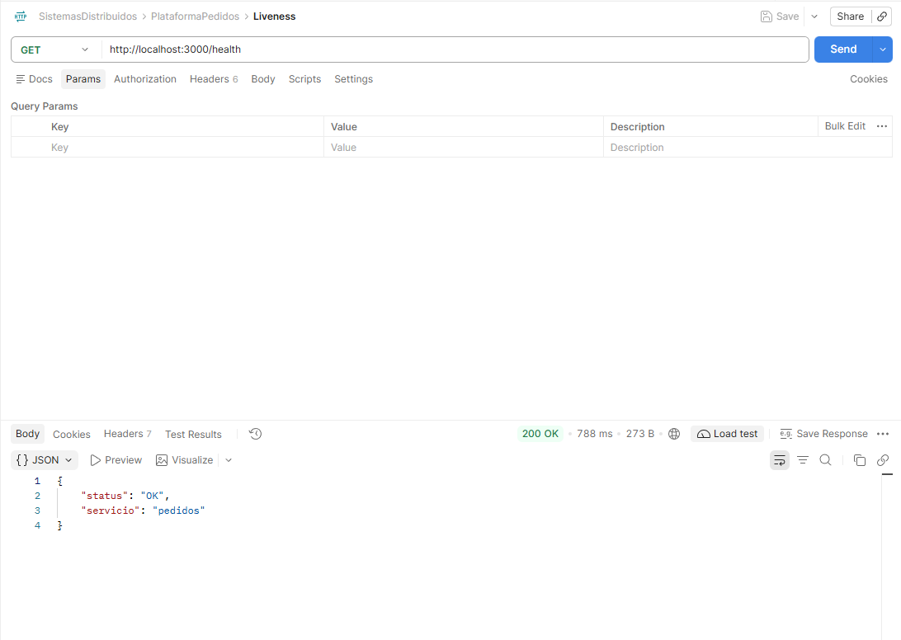
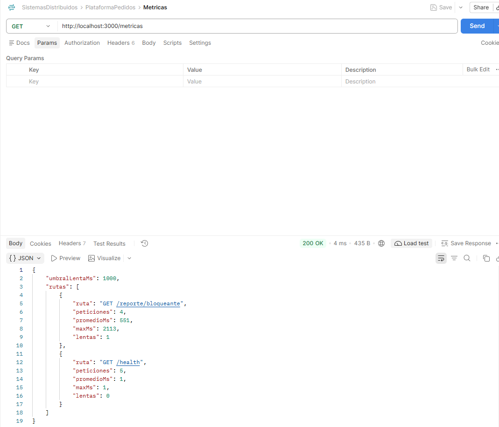

# S2 - Interceptor de métricas

## 1. Prueba realizada

Se ejecutó el endpoint `/reporte/bloqueante` y,
mientras se realizaba el cálculo de números primos,
se envió una petición a `/health` desde Postman.

## 2. Resultado de /health

- **Estado HTTP:** 200 OK
- **Tiempo en Postman:** 788 ms

### Evidencia de /health



## 3. Respuesta de /metricas

```json
{
  "umbralLentaMs": 1000,
  "rutas": [
    {
      "ruta": "GET /reporte/bloqueante",
      "peticiones": 4,
      "promedioMs": 551,
      "maxMs": 2113,
      "lentas": 1
    },
    {
      "ruta": "GET /health",
      "peticiones": 5,
      "promedioMs": 1,
      "maxMs": 1,
      "lentas": 0
    }
  ]
}
```

### Evidencia de /metricas



## 4. Análisis

Postman mide el tiempo total desde que envía la petición hasta recibir la respuesta.  
El interceptor mide desde que Express comienza a procesarla hasta que termina.  
El cálculo bloqueante mantiene ocupado el hilo principal de Node.js.  
Por esta razón, `/health` debe esperar hasta que termine el cálculo.  
El cliente experimenta una demora, aunque el servidor devuelve 200 OK.  
Esto evidencia un problema de rendimiento y disponibilidad.
